[Portfolio](https://franzecalleja.vercel.app) · [LinkedIn](https://www.linkedin.com/in/franze-calleja) · [Email](mailto:franzewilliamcalleja@gmail.com) · [Book a call](https://calendly.com/franzewilliamcalleja/meet-with-me)

### Hi, I'm Franze 👋

Full-stack software engineer from the Philippines. I build production web, mobile, and AI-powered systems for a university, a Canadian startup, and freelance clients, and I run them too: Docker, CI/CD, and Prometheus/Grafana observability across 10+ services.

Open to part-time roles and freelance projects.

### Featured work

- **[EUC Academic Portal](https://collegeportal.mseufcandelaria.com)**: admissions, enrollment, and grade evaluation for 500+ applicants per term.
- **[MSEUF-Candelaria Portal & CMS](https://mseufcandelaria.com)**: the university's website and custom CMS, with a Gemini RAG chat assistant.
- **[PHD Map](https://phdmap.raones.cloud)**: peer-to-peer parking marketplace for Toronto, on mobile and web.
- **[Kairos](https://github.com/franze-calleja/kairos)**: open-source, self-hosted stock and ETF research tool where every AI claim cites its source.

[All projects →](https://franzecalleja.vercel.app/projects)

### Stack

My portfolio also has a <a href="https://franzecalleja.vercel.app/game">playable pixel game</a> and an <a href="https://franzecalleja.vercel.app/chat">AI assistant</a> that answers questions about my work.
